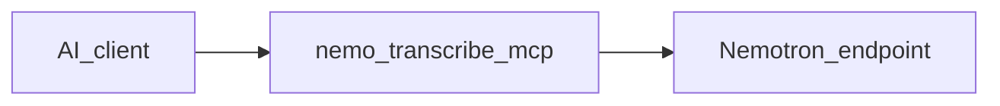

# Nemotron Transcribe MCP

[](https://github.com/AdrianBinDC/nemo-transcribe-mcp/actions/workflows/ci.yml)
[](LICENSE)
[](https://www.python.org/downloads/)
[](https://modelcontextprotocol.io)
[](https://docs.astral.sh/uv/)

MCP server that exposes transcription tools over the [Model Context Protocol](https://modelcontextprotocol.io) and calls an already-running [Nemotron 3.5 Transcribe](https://huggingface.co/nvidia/NVIDIA-Nemotron-3.5-Transcribe-30B-A4B) endpoint. It does not download weights or start the model.

Long files are cut at a pause (~55 minutes) and sent one piece at a time. With `speakers` 2–8, joins overlap by 10 seconds and speaker tags are remapped across pieces. It also translates: same language → same language, or either direction with English on one side. A YouTube link is saved first, then handled like a file. This checkpoint returns no word times—use another model for SRT/VTT.

## Why this stack

- Your endpoint, your network: audio stays on your machine or LAN
- Long-form + speaker tags (`<spk:0>`…`<spk:7>`), pause-aware chunking
- Translation via `translate`: stay in-language, or English ↔ supported language
- Agent-ready MCP tools (Cursor, Hermes)—not a one-off script

## Architecture



## MCP Tools

| Tool | Inputs | Returns |
| --- | --- | --- |
| `transcribe` | `path`, `speakers` 0 or 2–8, `style`, `wait_seconds` | transcript text, or job JSON if still running |
| `translate` | `path`, source/target language, `wait_seconds` | translation text or job JSON |
| `ask_about_audio` | `path`, `question`, optional span | answer or job JSON |
| `identify_language` | `path`, optional candidates | language label |
| `list_languages` | — | JSON language matrix |
| `get_job_status` | `job_id`, `wait_seconds` | status JSON |
| `get_job_result` | `job_id`, optional `offset`/`limit` | transcript text slice |
| `list_jobs` | optional `state`, `limit` | job list JSON |
| `cancel_job` | `job_id` | cancel ack JSON |

Sample call:

```json
{
  "name": "transcribe",
  "arguments": {
    "path": "/data/audio/episode.m4a",
    "speakers": 4,
    "style": "clean"
  }
}
```

`style` is `verbatim` (default), `clean`, `technical`, or `raw_dictation`. Long work returns a job id after `wait_seconds` (default 25); use `get_job_status` / `get_job_result`—do not poll in a tight loop.

## How it registers

```python
server = MCPServer(name="nemo-transcribe", instructions="...")


@server.tool(description="Speech to text for one audio file or one YouTube link. ...")
def transcribe(
    path: str, speakers: int = 0, style: str = "verbatim", wait_seconds: float = 25
) -> str: ...
```

Typed tool args come from the Python signatures; the client sees them as the MCP input schema.

## Languages

The server hears the language in the file.

| From | To |
| --- | --- |
| Supported language | Same supported language |
| Non-English Supported | English |
| English | Non-English Supported |

### Leading

State of the art, or close to it, out of the box.

| Language | Flag | ISO 639-1 | Translate |
| --- | --- | --- | --- |
| Czech | 🇨🇿 | `cs` | Yes |
| Dutch | 🇳🇱 | `nl` | Yes |
| English | 🇺🇸 | `en` | Yes |
| French | 🇫🇷 | `fr` | Yes |
| German | 🇩🇪 | `de` | Yes |
| Hindi | 🇮🇳 | `hi` | Yes |
| Italian | 🇮🇹 | `it` | Yes |
| Korean | 🇰🇷 | `ko` | Yes |
| Polish | 🇵🇱 | `pl` | Yes |
| Portuguese | 🇧🇷 | `pt` | Yes |
| Russian | 🇷🇺 | `ru` | Yes |
| Slovak | 🇸🇰 | `sk` | Yes |
| Spanish | 🇪🇸 | `es` | Yes |

### Production-ready

Production-level quality.

| Language | Flag | ISO 639-1 | Translate |
| --- | --- | --- | --- |
| Bulgarian | 🇧🇬 | `bg` | Yes |
| Croatian | 🇭🇷 | `hr` | Yes |
| Danish | 🇩🇰 | `da` | Yes |
| Estonian | 🇪🇪 | `et` | Yes |
| Finnish | 🇫🇮 | `fi` | Yes |
| Hungarian | 🇭🇺 | `hu` | Yes |
| Japanese | 🇯🇵 | `ja` | Yes |
| Latvian | 🇱🇻 | `lv` | Yes |
| Lithuanian | 🇱🇹 | `lt` | Yes |
| Romanian | 🇷🇴 | `ro` | Yes |
| Slovenian | 🇸🇮 | `sl` | Yes |
| Swedish | 🇸🇪 | `sv` | Yes |
| Thai | 🇹🇭 | `th` | Yes |
| Turkish | 🇹🇷 | `tr` | No |
| Ukrainian | 🇺🇦 | `uk` | Yes |

### Supported

Supported, and fine-tuning can help.

| Language | Flag | ISO 639-1 | Translate |
| --- | --- | --- | --- |
| Arabic | 🇪🇬 | `ar` | Yes |
| Bengali | 🇧🇩 | `bn` | No |
| Chinese | 🇨🇳 | `zh` | Yes |
| Greek | 🇬🇷 | `el` | Yes |
| Hebrew | 🇮🇱 | `he` | Yes |
| Indonesian | 🇮🇩 | `id` | No |
| Maltese | 🇲🇹 | `mt` | Yes |
| Marathi | 🇮🇳 | `mr` | No |
| Norwegian | 🇳🇴 | `no` | No |
| Tagalog | 🇵🇭 | `tl` | No |
| Tamil | 🇮🇳 | `ta` | No |
| Telugu | 🇮🇳 | `te` | No |
| Vietnamese | 🇻🇳 | `vi` | No |

## Requirements

- An already-running Nemotron 3.5 Transcribe endpoint (this repo does not start the model)
- Docker Compose **or** Python 3.12+, [uv](https://docs.astral.sh/uv/), and `ffmpeg`/`ffprobe` on your `PATH`

Settings live in `.env` (copy from `.env.example`). Names and defaults are documented there once. Compose and the app only read those names.

## Docker (home)

One path: Compose starts the MCP; Hermes connects over HTTP.

1. Copy settings and edit them:

```bash
cp .env.example .env
```

Set at least:

- `NEMOTRON_BASE_URL=http://host.docker.internal:8010/v1` (model on the same machine; use `127.0.0.1` only without Docker)
- `MCP_AUTH_TOKEN=` to a long random string

`.env` is **not** copied into the image. Compose reads it on the host and injects the values when the container starts (`env_file` in `compose.yaml`).

2. Start / stop:

```bash
docker compose up -d --build
docker compose logs -f mcp
docker compose down
```

Image name: `nemo-transcribe-mcp:0.1.0`. MCP listens inside the container on port `8080` and is published on the host as `127.0.0.1:8083` by default (`MCP_HOST_PORT`).

3. Hermes (`~/.hermes/config.yaml`):

```yaml
mcp_servers:
  nemo-transcribe:
    url: "http://127.0.0.1:8083/mcp"
    headers:
      Authorization: "Bearer YOUR_TOKEN_FROM_ENV"
    timeout: 300
    connect_timeout: 60
```

4. Audio: put files in `./audio` on the host. Ask Hermes to use `/data/audio/your-file.m4a` (that is the path inside the container).

5. If the MCP cannot reach the model: inside Docker, `localhost` means the container. Prefer `host.docker.internal` for a model on the same host.

Check the process is up: `curl -s http://127.0.0.1:8083/healthz`

## Without Docker

```bash
uv sync
cp .env.example .env
```

Edit `.env` and set `NEMOTRON_BASE_URL` (for a local process, `http://127.0.0.1:8010/v1` is fine). Leave `MCP_TRANSPORT=stdio`.

```bash
uv run nemo-transcribe-mcp
```

Log lines go to stderr. Default format is one JSON object per line. Set `NEMOTRON_LOG_FORMAT=text` for a plain line in a terminal.

Cursor can launch it from this directory:

```json
{
  "mcpServers": {
    "nemo-transcribe": {
      "command": "uv",
      "args": ["run", "nemo-transcribe-mcp"]
    }
  }
}
```

Ask the client to transcribe a file path (tool: `transcribe`).

## Tests and lint

```bash
uv run pytest
uv run ruff check .
uv run ruff format --check .
npm install
npm run check:yaml
```

Ruff covers Python. Prettier covers YAML (`compose.yaml`, `prompts.yaml`, `languages.yaml`).

The same checks run in GitHub Actions on every pull request (workflow: `.github/workflows/ci.yml`).

The tests do not call a model. They do need `ffmpeg` and `ffprobe`.
