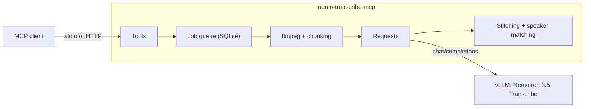

# Nemotron Transcribe MCP

[](https://github.com/AdrianBinDC/nemo-transcribe-mcp/actions/workflows/ci.yml)
[](LICENSE)
[](https://www.python.org/downloads/)
[](https://modelcontextprotocol.io)
[](https://docs.astral.sh/uv/)

An [MCP](https://modelcontextprotocol.io) server for NVIDIA's [Nemotron 3.5 Transcribe](https://huggingface.co/nvidia/NVIDIA-Nemotron-3.5-Transcribe-30B-A4B). It gives an agent tools for transcription, speaker labels on multi-hour recordings, translation, language identification, and questions about audio.

It talks to a vLLM endpoint you already run. Audio stays on your machine or LAN.

```text
You:   Transcribe ~/audio/team-offsite.m4a and label who's talking.
Agent: transcribe(path, speakers=2) -> job id -> get_job_status -> get_job_result

You:   Between minutes 40 and 55, what did they decide about the launch date?
Agent: ask_about_audio(path, question, start=2400, end=3300)
```

## Why a server and not a script

Nemotron 3.5 Transcribe is a language model with speech and speaker encoders attached (34B parameters, about 4.3B active). One chat endpoint handles every task, and the prompt picks which one. Each task needs different prompts, sampling, and token limits, and a request can hold only about an hour of audio. This server handles that so the agent doesn't have to.

| Task | Model constraint | What the server does |
| --- | --- | --- |
| Transcription | Prompt wording sets the style | Four styles from versioned prompt templates |
| Speaker labels | Tags up to 8 speakers, but numbering restarts every request | Matches labels across chunks |
| Long audio | About 1 hour per request | Splits at pauses into ≤55 min pieces, then joins them |
| Translation | English must be one side | Checks the pair; detects the source language if not given |
| Language ID | Fixed label set | Samples 10 s of speech, skipping leading silence |
| Audio Q&A | Reasoning mode, 16,384-token budget | Uses the card's reasoning settings; rejects spans over ~22 min |

## Architecture



## How it works

**Long files.** Audio is converted to 16 kHz mono PCM. Files over 55 minutes are cut at the longest pause near the end of each window. If there is no pause, the next piece starts 5 seconds early so no words are lost. Repeated words at each join are removed.

**Speakers across chunks.** The model tells up to eight speakers apart on its own and tags each turn in the transcript:

```text
<spk:0> Okay, let's start with the launch date.
<spk:1> I'd push it a week. QA needs more time.
<spk:0> Agreed. Let's say the fourteenth.
```

It numbers speakers from 0 on every request, though. With speaker labels on, each piece overlaps the previous one by 10 seconds. The overlapping words show which new label matches which old one. If the match is weak (under 60% agreement) or ambiguous, the transcript gets a `[speaker-join-uncertain]` marker instead of a guess.

**Token limits.** Audio costs 12.5 tokens per second, so `max_tokens` is set to whatever the 65,536-token context has left. If the output is still cut off, that span is split in half and retried.

**Jobs.** Long work runs in the background. Each tool waits up to `wait_seconds` (default 25), then returns a job id and a note telling the agent what to do next. Jobs are stored in SQLite. Repeat requests return the cached result, an interrupted job picks up where it stopped when asked again, and results can be read in pages.

Also: stdio and HTTP transports (HTTP uses a bearer token), JSON logs with secrets redacted, `init` and `doctor` setup commands, and 112 tests that run without a GPU.

## Results

NVFP4 checkpoint on a DGX Spark (GB10), vLLM 0.32.0:

- A 2 h 47 min podcast with speaker labels took about 18 minutes (about 9× real time).
- The same sentence from a 5-minute business-news clip:

| Call | Output |
| --- | --- |
| `transcribe`, `verbatim` | That's according to earnings calls this week at both UPS and Fed Ex, some of the biggest players in this space |
| `transcribe`, `raw_dictation` | that's according to earnings calls this week at both ups and fedex some of the biggest players in this space |
| `translate` to French | Selon les conférences téléphoniques sur les résultats de cette semaine chez UPS et FedEx, deux des acteurs les plus importants dans ce secteur |
| `identify_language` | `en_us` |

## Tools

| Tool | Inputs | Returns |
| --- | --- | --- |
| `transcribe` | `path`, `speakers` (0 or 2–8), `style` | Transcript or job id |
| `translate` | `path`, `target_language`, optional `source_language` | Translation or job id |
| `ask_about_audio` | `path`, `question`, optional `start`/`end` | Answer or job id |
| `identify_language` | `path`, optional `candidates` | Label such as `en_us` |
| `list_languages` | | Language matrix |
| `get_job_status` | `job_id` | Status |
| `get_job_result` | `job_id`, optional `offset`/`limit` | Result text |
| `list_jobs` | optional `state` | Recent jobs |
| `cancel_job` | `job_id` | Status |

`path` can be a local file or a YouTube link. Any `speakers` value from 2 to 8 turns on speaker matching across pieces; the model finds the actual speakers itself.

Styles: `verbatim` (default) keeps fillers. `clean` drops fillers and repeats. `technical` keeps emails, URLs, paths, and IDs exact. `raw_dictation` has no punctuation and spells out numbers.

## Setup

You need a running Nemotron 3.5 Transcribe endpoint (see the [model card](https://huggingface.co/nvidia/NVIDIA-Nemotron-3.5-Transcribe-30B-A4B) for `vllm serve`). Settings go in `.env`; [`.env.example`](.env.example) documents each one.

### Local (stdio)

Requires Python 3.12+, [uv](https://docs.astral.sh/uv/), and `ffmpeg`.

```bash
uv sync
cp .env.example .env               # set NEMOTRON_BASE_URL
uv run nemo-transcribe-mcp doctor  # checks endpoint, model, ffmpeg
```

Cursor config, run from this directory:

```json
{
  "mcpServers": {
    "nemo-transcribe": { "command": "uv", "args": ["run", "nemo-transcribe-mcp"] }
  }
}
```

### Docker (HTTP)

```bash
cp .env.example .env   # set NEMOTRON_BASE_URL and MCP_AUTH_TOKEN
docker compose up -d --build
curl -s http://127.0.0.1:8083/healthz
```

The MCP endpoint is `http://127.0.0.1:8083/mcp` with `Authorization: Bearer <MCP_AUTH_TOKEN>`. Put audio in `./audio` and pass it as `/data/audio/<file>`. For a model on the same host, use `host.docker.internal` in `NEMOTRON_BASE_URL`, not `localhost`.

Hermes example (`~/.hermes/config.yaml`):

```yaml
mcp_servers:
  nemo-transcribe:
    url: "http://127.0.0.1:8083/mcp"
    headers:
      Authorization: "Bearer YOUR_TOKEN_FROM_ENV"
    timeout: 300
```

## Languages

The model card rates 40 languages. Norwegian is also listed below; the card tested it but didn't rate it. Any of them can be transcribed. Translation needs English on one side.

<details>
<summary>Language matrix</summary>

**Leading**

| Language | | Code | Translate |
| --- | --- | --- | --- |
| Czech | 🇨🇿 | `cs` | ✅ |
| Dutch | 🇳🇱 | `nl` | ✅ |
| English | 🇺🇸 | `en` | ✅ |
| French | 🇫🇷 | `fr` | ✅ |
| German | 🇩🇪 | `de` | ✅ |
| Hindi | 🇮🇳 | `hi` | ✅ |
| Italian | 🇮🇹 | `it` | ✅ |
| Korean | 🇰🇷 | `ko` | ✅ |
| Polish | 🇵🇱 | `pl` | ✅ |
| Portuguese | 🇧🇷 | `pt` | ✅ |
| Russian | 🇷🇺 | `ru` | ✅ |
| Slovak | 🇸🇰 | `sk` | ✅ |
| Spanish | 🇪🇸 | `es` | ✅ |

**Production-ready**

| Language | | Code | Translate |
| --- | --- | --- | --- |
| Bulgarian | 🇧🇬 | `bg` | ✅ |
| Croatian | 🇭🇷 | `hr` | ✅ |
| Danish | 🇩🇰 | `da` | ✅ |
| Estonian | 🇪🇪 | `et` | ✅ |
| Finnish | 🇫🇮 | `fi` | ✅ |
| Hungarian | 🇭🇺 | `hu` | ✅ |
| Japanese | 🇯🇵 | `ja` | ✅ |
| Latvian | 🇱🇻 | `lv` | ✅ |
| Lithuanian | 🇱🇹 | `lt` | ✅ |
| Romanian | 🇷🇴 | `ro` | ✅ |
| Slovenian | 🇸🇮 | `sl` | ✅ |
| Swedish | 🇸🇪 | `sv` | ✅ |
| Thai | 🇹🇭 | `th` | ✅ |
| Turkish | 🇹🇷 | `tr` | ❌ |
| Ukrainian | 🇺🇦 | `uk` | ✅ |

**Supported** (may need fine-tuning)

| Language | | Code | Translate |
| --- | --- | --- | --- |
| Arabic | 🇪🇬 | `ar` | ✅ |
| Bengali | 🇧🇩 | `bn` | ❌ |
| Chinese | 🇨🇳 | `zh` | ✅ |
| Greek | 🇬🇷 | `el` | ✅ |
| Hebrew | 🇮🇱 | `he` | ✅ |
| Indonesian | 🇮🇩 | `id` | ❌ |
| Maltese | 🇲🇹 | `mt` | ✅ |
| Marathi | 🇮🇳 | `mr` | ❌ |
| Norwegian | 🇳🇴 | `no` | ❌ |
| Tagalog | 🇵🇭 | `tl` | ❌ |
| Tamil | 🇮🇳 | `ta` | ❌ |
| Telugu | 🇮🇳 | `te` | ❌ |
| Vietnamese | 🇻🇳 | `vi` | ❌ |

Language ID is weaker for Latvian and Slovenian and unavailable for Bengali, Marathi, Norwegian, Tamil, and Telugu. Audio Q&A was only evaluated in English.

</details>

## Limitations

- No word timestamps yet, so no SRT/VTT. The model can return per-word times and diarization segments, but this server doesn't request them yet.
- Not yet exposed: vocabulary hints, nearest-speaker-only transcription, PII tagging.
- Inputs are local files and YouTube links.
- One job runs at a time.

## Development

```bash
uv run pytest
uv run ruff check . && uv run ruff format --check .
npm install && npm run check:yaml
```

Tests need `ffmpeg` but not a model. CI runs the same checks on every pull request.
